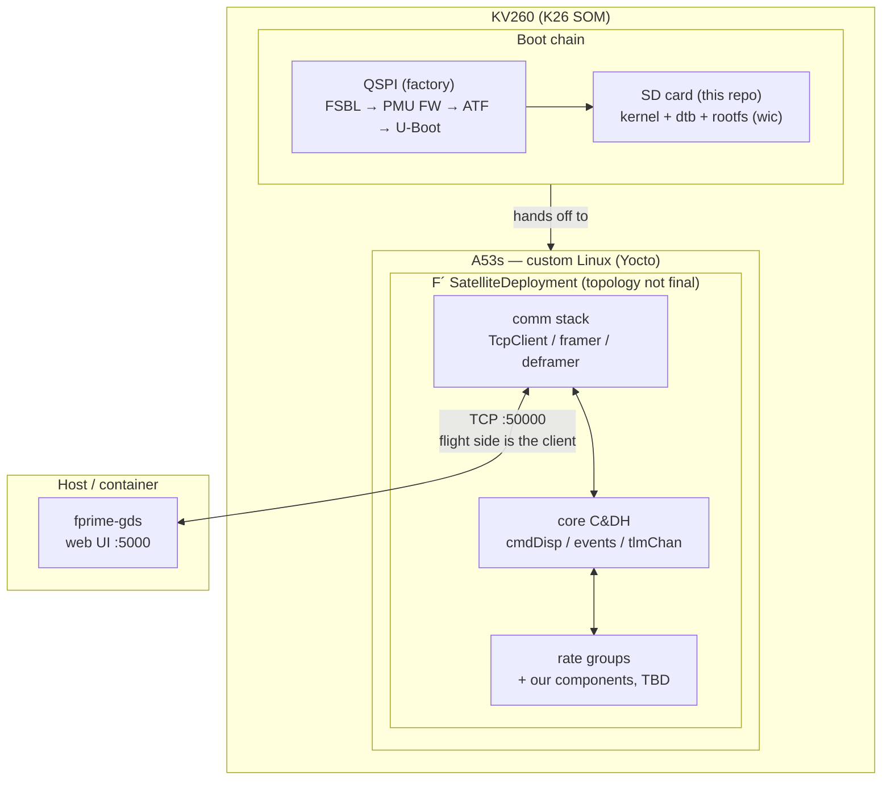

# Satellite Bus Emulator

A flight computer stack for the AMD Kria KV260 (Zynq UltraScale+ K26 SOM), built from source:
a custom embedded Linux platform (Yocto, rel-v2024.2) running an [F´](https://fprime.jpl.nasa.gov)
flight software deployment, with telemetry and commanding over Ethernet to a ground station (`fprime-gds`).

I built this to learn what actually sits between "bare silicon" and "spacecraft sends telemetry."
Turns out the answer is mostly BitBake errors.

```
┌─ KV260 ──────────────────────┐         ┌─ Host / container ────────┐
│  F´ SatelliteDeployment      │  TCP    │  fprime-gds               │
│  └─ custom Linux (Yocto)     ├────────►│  telemetry / commands     │
│     kernel + dtb + rootfs    │  :50000 │  web UI :5000             │
└──────────────────────────────┘         └───────────────────────────┘
```

## Architecture



## Layout

| Path | Contents |
|---|---|
| `satellite-bus/` | F´ project: components, `SatelliteDeployment` topology, cross toolchain |
| `build-k26/conf/` | Yocto build configuration (layers, machine, image tweaks) |
| `scripts/` | Container, repo checkout, environment, and SDK install scripts |
| `Dockerfile` | Build container (Yocto host deps + F´ host deps) |

`poky/` and `repos/` (BSP layers) are not tracked; `scripts/checkout-repos.sh` populates them.
F´ itself is a git submodule pinned in `satellite-bus/lib/fprime`.

The layer list in `init-yocto.sh` looks excessive for "just boot Linux." It isn't — the
`k26-smk-kv-sdt` machine hard-requires the SDT firmware flow, which drags in meta-openamp,
meta-virtualization, and friends. Each layer in that script is there because the build broke
without it.

## Build from a fresh clone

All build steps run inside the container.

```sh
git clone --recurse-submodules <this-repo>
cd satellite_bus_emulator
./scripts/checkout-repos.sh          # fetch poky + BSP layers (pinned branches)
./scripts/build-docker.sh
./scripts/run-docker.sh
```

### 1. Platform image (Yocto)

```sh
source scripts/init-yocto.sh                       # sets up env, registers layers
bitbake core-image-full-cmdline                    # bootable wic image
bitbake core-image-full-cmdline -c populate_sdk    # cross-SDK for F´ (long — hours, not minutes. once.)
./scripts/install-sdk.sh                           # installs SDK to ./sdk
```

Flash the image (host side):

```sh
xz -dc build-k26/tmp/deploy/images/k26-smk-kv-sdt/core-image-full-cmdline-k26-smk-kv-sdt.rootfs.wic.xz \
  | sudo dd of=/dev/sdX bs=4M status=progress   # replace sdX with your SD card. really. check twice.
```

MACHINE is `k26-smk-kv-sdt` (KV260, SDT flow), set in `build-k26/conf/local.conf`.

### 2. Flight software (F´)

```sh
source scripts/fprime-cross-env.sh     # SDK env + python venv
cd satellite-bus
fprime-util generate kv260-yocto && fprime-util build kv260-yocto
```

Cross-compilation uses the Yocto-generated SDK (`cmake/toolchain/kv260-yocto.cmake`) rather than
a distro cross-compiler, so the toolchain and the target rootfs share the same libc by
construction. That one decision quietly eliminates the whole "works on my toolchain, segfaults
on the board" class of bug.

## Run

Ground station first (container, ports 5000/50000 published). Order matters: the flight side is a
TCP client, so the ground has to be listening before the spacecraft dials in — same as real life.

```sh
fprime-gds -n \
  --dictionary satellite-bus/build-artifacts/kv260-yocto/SatelliteDeployment/dict/SatelliteDeploymentTopologyDictionary.json \
  --ip-address 0.0.0.0 --ip-port 50000
```

Then the flight binary (KV260, over ssh or serial — login `root`, no password, don't put this on a network you care about):

```sh
scp satellite-bus/build-artifacts/kv260-yocto/SatelliteDeployment/bin/SatelliteDeployment root@<kv260-ip>:
ssh root@<kv260-ip> ./SatelliteDeployment -a <host-ip> -p 50000
```

Telemetry appears at `http://<host-ip>:5000`. If nothing connects, check in this order: can the
board ping the host, is anything listening on 50000 (`ss -tlnp` in the container — it's usually
the GDS bound to 127.0.0.1 instead of 0.0.0.0), and does the dictionary match the binary you
actually flashed.

## Notes

- The KV260 boots its factory QSPI firmware (FSBL/PMU/ATF/U-Boot) and hands off to this image on
  SD. The Yocto build produces its own copies of all that boot firmware — they sit unused in the
  deploy directory. Leave QSPI alone; there's nothing to gain and a bricked SOM to lose.
- Serial console: 115200 baud on the carrier's USB-UART (`picocom -b 115200 /dev/ttyUSB1` — the
  FTDI chip enumerates several ports, console is usually the second).
